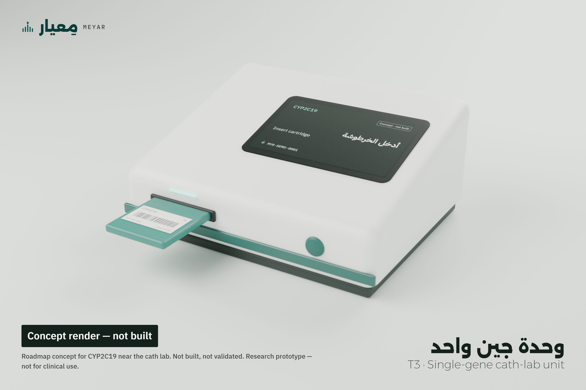

# Roadmap T3 — single-gene CYP2C19 unit for the cath lab

> **Concept render — not built.** Research prototype, not for clinical use.

*Render: `hardware/blender/renders/meyar-t3-single-gene-cathlab-unit-concept.png` (F1). It shows a design idea, not a device. No T3 hardware exists in this project and none is simulated as real.*

Tier T3 is the urgent branch of Meyar: a patient going to PCI needs a CYP2C19 answer before the first clopidogrel dose, too soon for a central-lab result (T2). Point-of-care CYP2C19 testing at that moment is already shown to be feasible. The Genomadix Cube holds FDA 510(k) clearance K220026 for CYP2C19 \*2, \*3 and \*17 (FDA 510(k) database), with a result in about one hour (Genomadix Cube clearance release, 2023; NICE DG59), and the RAPID GENE trial ran point-of-care CYP2C19 genotyping in patients undergoing PCI (Roberts et al., Lancet 2012). Feasibility is not outcome benefit: TAILOR-PCI (Pereira et al., JAMA 2020), a genotype-guided antiplatelet trial after PCI, did **not** show a statistically significant result on its primary endpoint, so Meyar claims no outcome benefit for T3. Our roadmap is narrower and honest: we would not build our own analyser; a cleared single-gene device would feed its call through the same germline gate (A6), FHIR store and non-interruptive order-sign card as every other source (B2/B3), so the prescriber sees one consistent alert path whether the genotype came from a kit, a lab or the cath lab. Device approval in Saudi Arabia (SFDA) is a future deployment step, not something this prototype has done.

## Sources
All rows in `docs/sources.md`: Genomadix Cube K220026; point-of-care CYP2C19 result in about 1 hour; RAPID GENE (Roberts et al., Lancet 2012); TAILOR-PCI primary endpoint not significant (Pereira et al., JAMA 2020).
